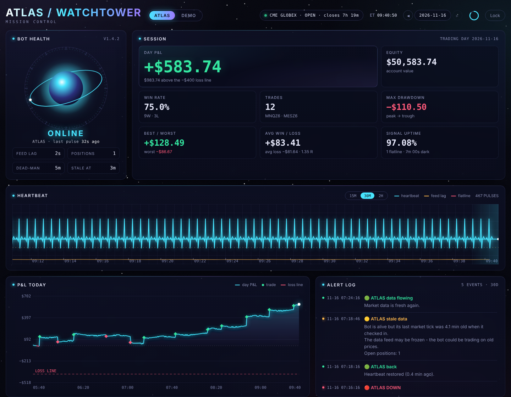
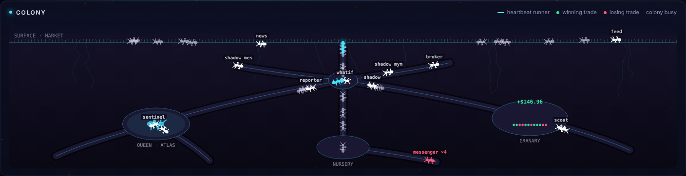

# Atlas Watchtower — Project 09

A dead-man switch and flight recorder for a live futures trading bot.

Atlas trades. Watchtower doesn't touch the account, the broker or the strategy. It only **listens**: the bot checks in every 30 seconds and reports each closed trade. If the bot goes quiet while the market is open, its data feed freezes, or the day's losses cross a line, a human hears about it within a minute, by email and Telegram. At the CME close it sends the day's report card.



**The rule it's built around: silence is the alarm.** A crashed bot can't send an error, so Watchtower treats missing heartbeats as the failure.

```
  Atlas (Linux host)                         AWS · us-east-2
 ┌───────────────────┐   POST /heartbeat    ┌──────────────┐     ┌────────────────────┐
 │ trading loop      │ ───every 30s───────▶ │ HTTP API     │ ──▶ │ Lambda: api        │
 │  └ watchtower     │   POST /trade        │ x-atlas-key  │     │  validate · write  │
 │    client thread  │ ───per close───────▶ │ throttled    │     └────┬──────────┬────┘
 └───────────────────┘                      └──────────────┘          ▼          ▼
                                                              DynamoDB state   S3 ledger (versioned,
                                                              + 90-day trades  Athena-partitioned)
          ┌─ every minute ──▶ Lambda: watchdog ─ reads state ─┐
Scheduler─┤                                                    ├─▶ SNS email + Telegram
          └─ 17:10 ET M–F ──▶ Lambda: report ── reads trades ─┘
                         CloudWatch alarms watch the watchdog itself
```



## Prices never fake a heartbeat

Market data goes to its own route, `POST /market`, and never touches `last_heartbeat`. In the real setup NinjaTrader keeps streaming candles even if the Atlas brain crashes, and if prices counted as "alive" the dead-man switch would never fire. A test proves it: eight minutes of live prices with a silent bot still raises DOWN.

## The console

Open the Watchtower URL in a browser and enter the key. The page is a live Matrix-style console that refreshes every 15 seconds:

- **Vital core:** a reactor ring that turns green for NOMINAL, amber for STALE FEED or LOSS LINE, red for FLATLINE and cyan when the market is closed, with a live "last pulse" counter
- **Session telemetry:** day P&L, equity, win rate, trades, max drawdown, best/worst, avg win/loss and signal uptime
- **Pulse monitor:** an ECG trace of every heartbeat, with flatlines drawn in red and feed lag in amber
- **Market:** live 1-minute candles of whatever the bot trades, built from the prices the bot itself sees, with every entry (▲ long / ▼ short) and exit drawn on the chart, plus last, bid × ask, session change and high/low
- **P&L trajectory:** the day's equity curve, with trade markers and the loss line
- **Alert log and trade tape:** every incident from the last 30 days, and every fill

The page itself is public HTML with nothing in it. All data comes from `GET /feed`, which needs the key, and the key only lives in that browser tab. It sends a strict CSP, `frame-ancestors 'none'` and no-referrer.

`python preview/build_preview.py` builds `preview/preview.html` with a fake backend, so you can look at it without AWS.

## What it alerts on

| Alert | Trigger | Why it matters |
|---|---|---|
| 🔴 **DOWN** | No heartbeat for 5 min during CME hours | Bot crashed, host died, network dropped, possibly holding a position |
| 🟡 **STALE DATA** | Bot is alive but its last market tick was 3+ min old when it checked in | It may be trading on frozen prices |
| 🟠 **LOSS LIMIT** | Day P&L below your line (set it under the prop firm's limit) | Gives a human time to step in before the firm's hard limit closes the account |
| 🟢 recovery | Each of the above clears | One alert to break, one to recover, never spam |
| 📊 **daily report** | 17:10 ET, Mon–Fri | Net P&L, win rate, best/worst, avg win/loss, max drawdown, equity |

It knows the CME Globex schedule (Sun 6pm → Fri 5pm ET, daily 5–6pm halt), so a quiet bot on Saturday isn't an emergency, and a Sunday-night session counts toward Monday's trading day.

## Design decisions

- **The client can't hurt the trader.** All network calls are on a background thread with 3-second timeouts, and every error is swallowed. If Watchtower is down, Atlas keeps trading.
- **Retries are safe.** Trades are written with a conditional put, so a re-sent trade is acknowledged and ignored. The client retries failed reports; duplicates never inflate P&L.
- **Who watches the watchtower?** CloudWatch alarms fire if the watchdog Lambda errors or stops running.
- **Least privilege, per job.** One code package, three Lambdas, three roles. The API can write state and `trades/*`, and nothing else; it can't send alerts. The report can write `reports/*` only.
- **The key is never typed.** Terraform generates it into SSM Parameter Store as a SecureString, the Lambda compares it in constant time, and you read it with one CLI command.
- **Two copies of the truth.** DynamoDB holds recent trades for fast reports (90-day TTL). S3 keeps every trade forever, versioned and partitioned `bot=/day=` so Athena can query it.
- **Built to live in its own AWS account.** `aws_profile` points it at a separate account under AWS Organizations, so the trading side and my portfolio projects can never touch each other.

## Cost

About **$0/month** at one bot: ~43k watchdog runs plus ~90k API calls a month fit inside the Lambda, API Gateway and DynamoDB free tiers, and S3 holds kilobytes. A $5 budget alarm is included anyway.

## Deploy

```powershell
copy terraform.tfvars.example terraform.tfvars   # set alert_email (+ aws_profile, Telegram, loss line)
terraform init
terraform apply                                  # 39 resources
terraform output watchtower_url
terraform output -raw key_command                # run the printed command to read the key
```

Confirm the SNS subscription email. Then on the Atlas host:

```python
from atlas_watchtower import Watchtower
wt = Watchtower(url=os.environ["WATCHTOWER_URL"], key=os.environ["WATCHTOWER_KEY"], bot="atlas").start()
wt.update(last_tick=tick_time, equity=equity, day_pnl=day_pnl, open_positions=n)   # in the loop
wt.candle("MNQZ6", t, o, h, l, c, v)               # each finished 1-min candle (what AtlasFeed already sends Atlas)
# or: wt.tick("MNQZ6", price, bid=bid, ask=ask)     # raw ticks; the client builds the candles itself
wt.trade(id=..., symbol=..., side="long", qty=..., entry=..., exit=..., pnl=..., opened_at=..., closed_at=...)  # per close
```

Not in Python? It's two JSON POSTs with one header:

```bash
curl -X POST "$WATCHTOWER_URL/heartbeat" -H "x-atlas-key: $WATCHTOWER_KEY" \
     -H "content-type: application/json" -d '{"bot":"atlas","last_tick":"2026-11-18T14:00:00Z"}'
```

## Tests

```
pip install -r tests/requirements.txt
pytest -q          # 22 tests: market clock, auth, validation, idempotency, every alert path, report math, dashboard feed, live market bars, client safety
```

Everything runs offline against moto with a frozen clock.

*Monitoring only. Not investment advice, and nothing here places or manages trades.*
